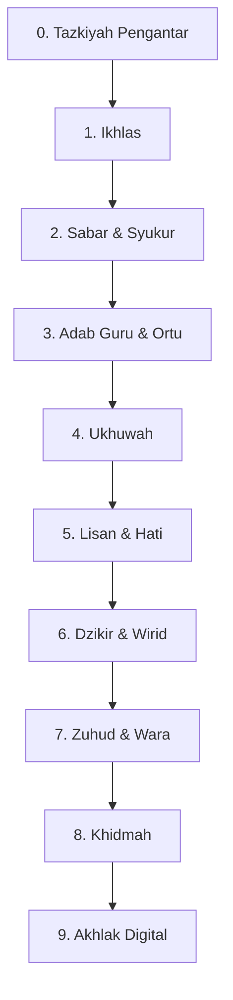

# Roadmap Akhlak & Tasawuf

> Tazkiyatun nafs: membersihkan hati sambil tetap syariat. Target: akhlak berubah, bukan sekadar tahu.

**Untuk siapa:** semua santri, paralel dengan roadmap lain.
**Prasyarat:** shalat 5 waktu terjaga.
**Estimasi:** seumur hidup; fondasi 6 bulan.

## Peta

### Checklist

- [ ] 0. [Tazkiyatun nafs](content/tazkiyatun-nafs.md)
- [ ] 1. [Ikhlas](content/ikhlas.md)
- [ ] 2. [Sabar & syukur](content/sabar-syukur.md)
- [ ] 3. [Adab guru & orang tua](content/adab-guru-ortu.md)
- [ ] 4. [Ukhuwah](content/ukhuwah.md)
- [ ] 5. [Lisan & hati](content/lisan-hati.md)
- [ ] 6. [Dzikir & wirid](content/dzikir-wirid.md)
- [ ] 7. [Zuhud & wara'](content/zuhud-wara.md)
- [ ] 8. [Khidmah](content/khidmah.md)
- [ ] 9. [Akhlak digital](content/akhlak-digital.md)
