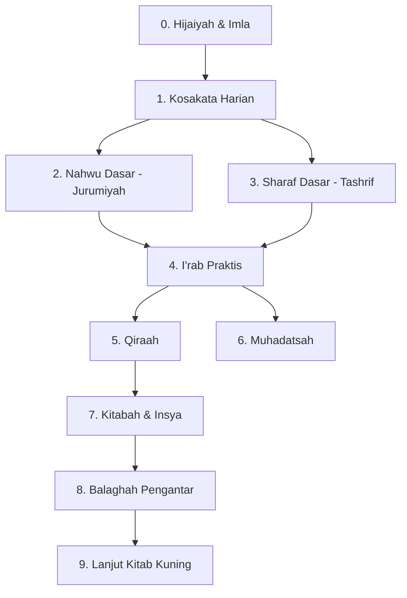

# Roadmap Bahasa Arab (Ilmu Alat)

> Kunci kitab kuning. Target: bisa mengi'rab kalimat sederhana, mentashrif fi'il, dan membaca kitab gundul tingkat dasar (Safinatun Naja) dalam 12–18 bulan.

**Untuk siapa:** semua santri yang ingin baca kitab kuning.
**Prasyarat:** lancar baca Qur'an.
**Estimasi:** 12–18 bulan @ 1 jam/hari.
**Urutan wajib:** kosakata → nahwu dasar + sharaf dasar (paralel) → i'rab → qira'ah–muhadatsah → balaghah (opsional).

## Peta

### Checklist

- [ ] 0. [Hijaiyah & imla](content/hijaiyah-imla.md)
- [ ] 1. [Kosakata harian](content/kosakata.md) — 500 kata
- [ ] 2. [Nahwu dasar](content/nahwu-dasar.md) — Jurumiyah khatam
- [ ] 3. [Sharaf dasar](content/sharaf-dasar.md) — tashrif istilahi & lughawi
- [ ] 4. [I'rab praktis](content/irab.md)
- [ ] 5. [Qira'ah](content/qiraah.md)
- [ ] 6. [Muhadatsah](content/muhadatsah.md)
- [ ] 7. [Istima'](content/istima.md)
- [ ] 8. [Kitabah & insya](content/kitabah-insya.md)
- [ ] 9. [Balaghah pengantar](content/balaghah.md)
