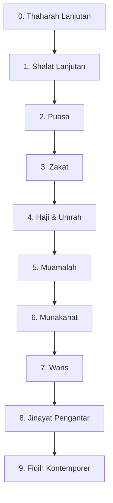

# Roadmap Fiqih Ibadah & Muamalah

> Fiqih praktis madzhab Syafi'i: dari thaharah sampai waris & fiqih kontemporer. Target: bisa beribadah dengan benar dan menjawab masalah harian dengan rujukan.

**Untuk siapa:** semua santri. Bisa dipelajari paralel dengan fondasi/kitab kuning.
**Prasyarat:** [Thaharah](../fondasi-santri/content/thaharah.md) + [Shalat](../fondasi-santri/content/shalat.md).
**Estimasi:** 6–12 bulan.
**Catatan:** fatwa resmi tetap lewat guru/lembaga (NU/MUI/pesantren). Repo ini bahan belajar, bukan fatwa.

## Peta

### Checklist

- [ ] 0. [Thaharah lanjutan](content/thaharah-lanjutan.md)
- [ ] 1. [Shalat lanjutan](content/shalat-lanjutan.md)
- [ ] 2. [Puasa](content/puasa.md)
- [ ] 3. [Zakat](content/zakat.md)
- [ ] 4. [Haji & umrah](content/haji-umrah.md)
- [ ] 5. [Muamalah](content/muamalah.md)
- [ ] 6. [Munakahat](content/munakahat.md)
- [ ] 7. [Waris](content/waris.md)
- [ ] 8. [Jinayat pengantar](content/jinayat.md)
- [ ] 9. [Fiqih kontemporer](content/fiqih-kontemporer.md)
