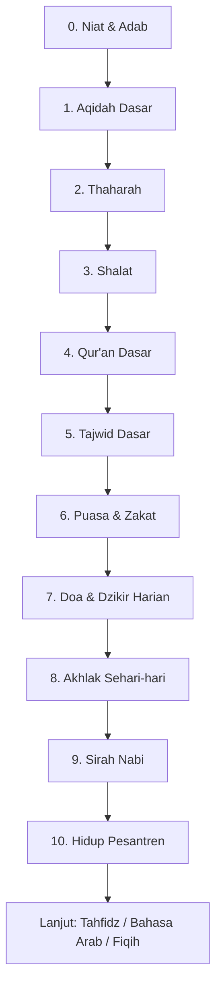

# Roadmap Fondasi Santri (Pemula)

> Untuk santri baru 0–12 bulan. Target: aqidah lurus, ibadah benar, bisa baca Qur'an dengan tajwid dasar, hafal doa harian, dan paham adab pesantren.

**Untuk siapa:** santri baru, mualaf, atau siapa pun yang mulai dari nol.
**Prasyarat:** bisa membaca huruf latin. Tidak perlu bisa Arab.
**Estimasi:** 6–12 bulan @ 1–2 jam/hari + setoran ke ustadz tiap pekan.
**Cara setor:** tiap topik ada target hafalan/praktik. Minta tashih ke ustadz sebelum lanjut.

## Peta belajar (urut dari atas)

### Checklist

- [ ] 0. [Niat & adab menuntut ilmu](content/niat-adab.md) — target: hafal niat, paham Ta'limul Muta'allim bab 1
- [ ] 1. [Aqidah dasar](content/aqidah-dasar.md) — target: hafal sifat 20 + dalil pendek, Aqidatul Awam 1–20 bait
- [ ] 2. [Thaharah](content/thaharah.md) — target: praktik wudhu & tayamum benar
- [ ] 3. [Shalat](content/shalat.md) — target: shalat 5 waktu + hafal bacaan shalat
- [ ] 4. [Qur'an dasar](content/quran-dasar.md) — target: baca Iqra'/Qira'ati jilid 1–6 lancar
- [ ] 5. [Tajwid dasar](content/tajwid-dasar.md) — target: nun sukun, mim sukun, mad dasar
- [ ] 6. [Puasa & zakat](content/puasa-zakat.md) — target: paham rukun & batal puasa/zakat fitrah
- [ ] 7. [Doa & dzikir harian](content/doa-dzikir-harian.md) — target: 15 doa harian + Al-Ma'tsurat
- [ ] 8. [Akhlak sehari-hari](content/akhlak-sehari-hari.md) — target: adab makan, tidur, bertamu, bermedsos
- [ ] 9. [Sirah Nabi](content/sirah-nabi.md) — target: urutan 25 nabi + fase Makkah–Madinah
- [ ] 10. [Hidup pesantren](content/hidup-pesantren.md) — target: tata tertib, piket, sorogan–bandongan

Setelah lulus semua: pilih jalur berikutnya → [Tahfidz](../tahfidz-quran/) atau [Bahasa Arab](../bahasa-arab/) atau [Fiqih](../fiqih-ibadah/).
