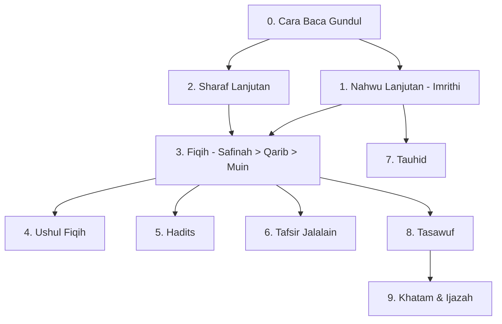

# Roadmap Kitab Kuning

> Jalur alim: membaca kitab gundul (tanpa harakat) langsung dari ulama, dari Safinah sampai Fathul Mu'in & Jalalain.

**Untuk siapa:** santri yang sudah lulus [Bahasa Arab](../bahasa-arab/) dasar (Jurumiyah + tashrif).
**Prasyarat:** bisa i'rab + tashrif. Kalau belum, kembali ke roadmap Bahasa Arab.
**Estimasi:** 3–6 tahun (bertahap, tidak bisa dikilat).
**Sistem:** sorogan (individu) + bandongan (kuliahan). Wajib talaqqi, tidak cukup baca terjemah.

## Urutan kitab (madzhab Syafi'i + Ahlussunnah, umum di pesantren Jawa)

### Checklist

- [ ] 0. [Cara baca kitab gundul](content/cara-baca-gundul.md)
- [ ] 1. [Nahwu lanjutan](content/nahwu-lanjutan.md) — Imrithi → Alfiyah (pilihan)
- [ ] 2. [Sharaf lanjutan](content/sharaf-lanjutan.md)
- [ ] 3. [Fiqih bertingkat](content/fiqih-bertingkat.md) — Safinah → Fathul Qarib → Fathul Mu'in
- [ ] 4. [Ushul fiqih](content/ushul-fiqih.md) — Waraqat → Ghayah
- [ ] 5. [Hadits](content/hadits.md) — Arbain → Bulughul Maram
- [ ] 6. [Tafsir](content/tafsir.md) — Jalalain
- [ ] 7. [Tauhid lanjutan](content/tauhid-lanjutan.md)
- [ ] 8. [Tasawuf kitab](content/tasawuf-kitab.md) — Bidayah → Ihya (pengantar)
- [ ] 9. [Khatam & ijazah](content/khatam-ijazah.md)
