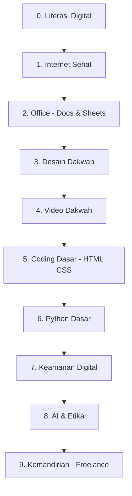

# Roadmap Santri Digital

> Santri melek teknologi: bisa komputer, desain dakwah, coding dasar, dan aman di internet — tanpa kehilangan adab.

**Untuk siapa:** santri SMP–kuliah, pengurus media pesantren, dai digital.
**Prasyarat:** bisa baca-tulis + punya HP/laptop (bisa pinjam lab).
**Estimasi:** 4–6 bulan @ 4 jam/pekan.
**Prinsip:** teknologi untuk dakwah & kemandirian, bukan untuk maksiat & candu.

## Peta

### Checklist

- [ ] 0. [Literasi digital](content/literasi-digital.md)
- [ ] 1. [Internet sehat](content/internet-sehat.md)
- [ ] 2. [Office](content/office.md)
- [ ] 3. [Desain dakwah](content/desain-dakwah.md)
- [ ] 4. [Video dakwah](content/video-dakwah.md)
- [ ] 5. [Coding dasar](content/coding-dasar.md)
- [ ] 6. [Python dasar](content/python-dasar.md)
- [ ] 7. [Keamanan digital](content/keamanan-digital.md)
- [ ] 8. [AI & etika](content/ai-etika.md)
- [ ] 9. [Kemandirian digital](content/kemandirian-digital.md)
