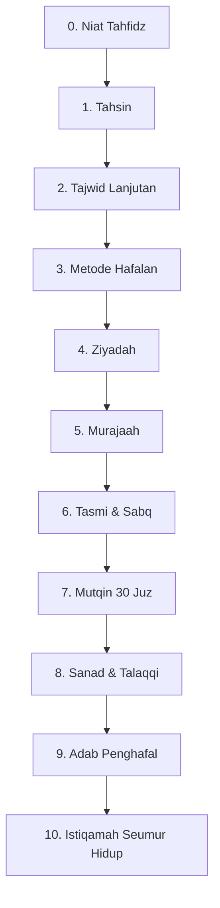

# Roadmap Tahfidz Qur'an

> Dari tahsin sampai mutqin & bersanad. Target: 30 juz dengan muraja'ah yang terjaga, bukan sekadar setor.

**Untuk siapa:** santri yang sudah lancar baca Qur'an (khatam Iqra'/Qira'ati) dan siap menghafal.
**Prasyarat:** [Tajwid dasar](../fondasi-santri/content/tajwid-dasar.md) + komitmen 2–3 jam/hari.
**Estimasi:** 2–4 tahun untuk 30 juz (tergantung ziyadah/hari). 1 halaman/hari ≈ 600 hari ≈ 2 tahun.
**Wajib:** punya guru tasmi' (talaqqi). Jangan menghafal tanpa tasmi'.

## Peta

### Checklist

- [ ] 0. [Niat tahfidz](content/niat-tahfidz.md)
- [ ] 1. [Tahsin](content/tahsin.md) — bacaan ditashih total sebelum tambah hafalan
- [ ] 2. [Tajwid lanjutan](content/tajwid-lanjutan.md)
- [ ] 3. [Metode hafalan](content/metode-hafalan.md) — takrir, tasmi', kitabah
- [ ] 4. [Ziyadah](content/ziyadah.md) — manajemen tambah hafalan
- [ ] 5. [Muraja'ah](content/murajaah.md) — sabaq, sabqi, manzil
- [ ] 6. [Tasmi' & sabq](content/tasmi-sabq.md) — ujian per juz & per 5 juz
- [ ] 7. [Mutqin](content/mutqin.md) — 30 juz lancar
- [ ] 8. [Sanad & talaqqi](content/sanad-talaqqi.md)
- [ ] 9. [Adab penghafal](content/adab-penghafal.md)
- [ ] 10. [Istiqamah](content/istiqamah.md)
